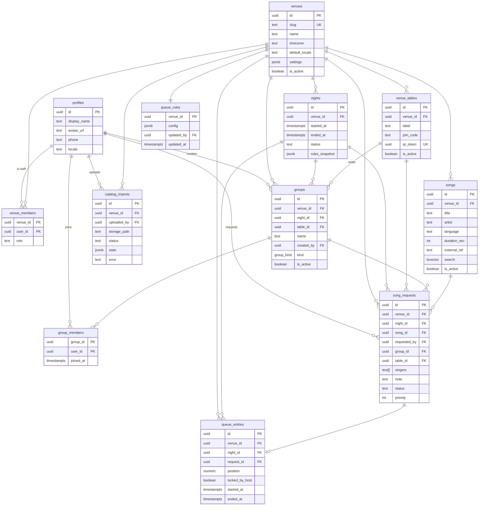

# Data Model

All tables live in the `public` schema of Supabase Postgres. Conventions:

- Primary keys are `uuid` (`gen_random_uuid()`) unless stated otherwise.
- Every table has `created_at timestamptz not null default now()` and `updated_at timestamptz not null default now()` (maintained by a shared `set_updated_at()` trigger), except where noted.
- Every tenant-owned table carries `venue_id uuid not null references venues(id)`; it is the RLS boundary.
- Enumerations are Postgres `enum` types or `text` with a `check` constraint; the allowed values are listed per column.
- `auth.users` is Supabase's managed table; `profiles` mirrors it 1:1.

## 1. Tables

### profiles

One row per authenticated user, created by a trigger on `auth.users` insert.

| Column       | Type                       | Notes                                         |
| ------------ | -------------------------- | --------------------------------------------- |
| id           | uuid PK                    | `references auth.users(id) on delete cascade` |
| display_name | text                       | From provider or asked after phone login      |
| avatar_url   | text null                  |                                               |
| phone        | text null                  | E.164, copied from `auth.users.phone`         |
| locale       | text not null default 'he' | check in (`he`, `en`)                         |
| created_at   | timestamptz                |                                               |
| updated_at   | timestamptz                |                                               |

### venues

| Column                  | Type                                   | Notes                             |
| ----------------------- | -------------------------------------- | --------------------------------- |
| id                      | uuid PK                                |                                   |
| slug                    | text unique not null                   | URL-safe, lowercase               |
| name                    | text not null                          |                                   |
| timezone                | text not null default 'Asia/Jerusalem' | IANA zone                         |
| default_locale          | text not null default 'he'             | check in (`he`, `en`)             |
| settings                | jsonb not null default '{}'            | Branding, TV-screen options, misc |
| is_active               | boolean not null default true          |                                   |
| created_at / updated_at | timestamptz                            |                                   |

### venue_members

Staff of a venue. Guests are **not** members; they are linked through `group_members`.

| Column                  | Type          | Notes                             |
| ----------------------- | ------------- | --------------------------------- |
| venue_id                | uuid          | FK venues                         |
| user_id                 | uuid          | FK profiles                       |
| role                    | text not null | check in (`owner`, `admin`, `dj`) |
| created_at / updated_at | timestamptz   |                                   |

PK `(venue_id, user_id)`.

### venue_tables

| Column                  | Type                                    | Notes                                         |
| ----------------------- | --------------------------------------- | --------------------------------------------- |
| id                      | uuid PK                                 |                                               |
| venue_id                | uuid                                    | FK venues                                     |
| label                   | text not null                           | e.g. `T12`, `Bar 3`                           |
| join_code               | text not null                           | Short (4-6 chars), globally unique, uppercase |
| qr_token                | uuid not null default gen_random_uuid() | Encoded in the printed QR; rotatable          |
| is_active               | boolean not null default true           |                                               |
| created_at / updated_at | timestamptz                             |                                               |

Unique `(venue_id, label)`, unique `(join_code)` (guests type the code without naming the venue), unique `(qr_token)`.

### nights

One operating session. The queue belongs to a night.

| Column                  | Type                               | Notes                                     |
| ----------------------- | ---------------------------------- | ----------------------------------------- |
| id                      | uuid PK                            |                                           |
| venue_id                | uuid                               | FK venues                                 |
| started_at              | timestamptz not null default now() |                                           |
| ended_at                | timestamptz null                   |                                           |
| status                  | text not null default 'open'       | check in (`open`, `closed`)               |
| rules_snapshot          | jsonb not null                     | Copy of `queue_rules.config` at open time |
| created_at / updated_at | timestamptz                        |                                           |

Constraint: at most one `open` night per venue (partial unique index, see Indexes).

### groups

| Column                  | Type                          | Notes                                                                                 |
| ----------------------- | ----------------------------- | ------------------------------------------------------------------------------------- |
| id                      | uuid PK                       |                                                                                       |
| venue_id                | uuid                          | FK venues                                                                             |
| night_id                | uuid                          | FK nights                                                                             |
| table_id                | uuid null                     | FK venue_tables; null = not at a table                                                |
| name                    | text not null                 | Table label for `table` groups                                                        |
| created_by              | uuid                          | FK profiles                                                                           |
| kind                    | group_kind not null           | `table` (auto, one per table and night) or `adhoc` (named by a guest, invite by link) |
| is_active               | boolean not null default true |                                                                                       |
| created_at / updated_at | timestamptz                   |                                                                                       |

A guest is in at most one group per night: the join RPCs move them out of any other group of that night. Constraint: one active `table` group per `(night_id, table_id)` (partial unique index).

### group_members

| Column    | Type                               | Notes       |
| --------- | ---------------------------------- | ----------- |
| group_id  | uuid                               | FK groups   |
| user_id   | uuid                               | FK profiles |
| joined_at | timestamptz not null default now() |             |

PK `(group_id, user_id)`. No `updated_at`.

### songs

Venue catalog. Guests can only pick rows from their venue.

| Column                  | Type                          | Notes                                   |
| ----------------------- | ----------------------------- | --------------------------------------- |
| id                      | uuid PK                       |                                         |
| venue_id                | uuid                          | FK venues                               |
| title                   | text not null                 |                                         |
| artist                  | text not null                 |                                         |
| language                | text null                     | ISO 639-1 (`he`, `en`, ...) or null     |
| duration_sec            | int null                      |                                         |
| external_ref            | text null                     | VirtualDJ file path or id               |
| search                  | tsvector                      | Generated: `to_tsvector('simple', title |     | ' ' |     | artist)` |
| is_active               | boolean not null default true |                                         |
| created_at / updated_at | timestamptz                   |                                         |

Unique `(venue_id, title, artist)`.

### song_requests

| Column       | Type                            | Notes                                                                                     |
| ------------ | ------------------------------- | ----------------------------------------------------------------------------------------- |
| id           | uuid PK                         |                                                                                           |
| venue_id     | uuid                            | FK venues                                                                                 |
| night_id     | uuid                            | FK nights                                                                                 |
| song_id      | uuid                            | FK songs                                                                                  |
| requested_by | uuid                            | FK profiles                                                                               |
| group_id     | uuid null                       | FK groups                                                                                 |
| table_id     | uuid null                       | FK venue_tables                                                                           |
| singers      | text[] not null default '{}'    | Display names                                                                             |
| note         | text null                       | Max 200 chars                                                                             |
| status       | text not null default 'pending' | check in (`pending`, `approved`, `queued`, `now_singing`, `done`, `skipped`, `cancelled`) |
| priority     | int not null default 0          | Host-set; higher sorts earlier                                                            |
| created_at   | timestamptz                     |                                                                                           |
| updated_at   | timestamptz                     |                                                                                           |

Status lifecycle: `pending -> approved -> queued -> now_singing -> done`; `skipped` and `cancelled` are terminal from any non-terminal state. Without host approval, requests start at `queued`.

### queue_entries

| Column                  | Type                           | Notes                                              |
| ----------------------- | ------------------------------ | -------------------------------------------------- |
| id                      | uuid PK                        |                                                    |
| venue_id                | uuid                           | FK venues                                          |
| night_id                | uuid                           | FK nights                                          |
| request_id              | uuid unique not null           | FK song_requests                                   |
| position                | numeric not null               | Fractional rank; insert between a and b at (a+b)/2 |
| locked_by_host          | boolean not null default false | Pinned; `reorder()` does not move it               |
| started_at              | timestamptz null               | Set when `now_singing`                             |
| ended_at                | timestamptz null               | Set when `done` / `skipped`                        |
| created_at / updated_at | timestamptz                    |                                                    |

### queue_rules

| Column     | Type           | Notes                                        |
| ---------- | -------------- | -------------------------------------------- |
| venue_id   | uuid PK        | FK venues                                    |
| config     | jsonb not null | Schema in [QUEUE_RULES.md](./QUEUE_RULES.md) |
| updated_by | uuid null      | FK profiles                                  |
| updated_at | timestamptz    |                                              |

No `id`, no `created_at`.

### catalog_imports

| Column                  | Type                            | Notes                                                 |
| ----------------------- | ------------------------------- | ----------------------------------------------------- |
| id                      | uuid PK                         |                                                       |
| venue_id                | uuid                            | FK venues                                             |
| uploaded_by             | uuid                            | FK profiles                                           |
| storage_path            | text not null                   | `catalog-uploads/<venue_id>/<uuid>.<ext>`             |
| status                  | text not null default 'pending' | check in (`pending`, `processing`, `done`, `failed`)  |
| stats                   | jsonb not null default '{}'     | `{ inserted, updated, deactivated, skipped, errors }` |
| error                   | text null                       |                                                       |
| created_at / updated_at | timestamptz                     |                                                       |

## 2. Relationships

- `venues 1-n venue_members`, `venue_tables`, `nights`, `groups`, `songs`, `song_requests`, `queue_entries`, `catalog_imports`; `venues 1-1 queue_rules`.
- `profiles 1-n venue_members`, `group_members`, `song_requests (requested_by)`, `groups (created_by)`, `catalog_imports (uploaded_by)`.
- `nights 1-n groups`, `song_requests`, `queue_entries`.
- `venue_tables 1-n groups`, `song_requests (table_id)`.
- `groups 1-n group_members`, `song_requests`.
- `songs 1-n song_requests`.
- `song_requests 1-0..1 queue_entries`.

Cross-venue integrity: a trigger (or composite FK) asserts that `song_requests.song_id`, `night_id`, `group_id`, `table_id` all belong to the same `venue_id` as the request.

## 3. Indexes worth having

| Table           | Index                                                                                            | Purpose                                               |
| --------------- | ------------------------------------------------------------------------------------------------ | ----------------------------------------------------- |
| venue_members   | `(user_id)`                                                                                      | "my venues" lookup and RLS membership checks          |
| venue_tables    | unique `(join_code)`, unique `(qr_token)`, unique `(venue_id, label)`                            | Join by code / QR                                     |
| nights          | partial unique `(venue_id) where status = 'open'`                                                | One open night per venue                              |
| groups          | partial unique `(night_id, table_id) where kind = 'table' and is_active`                         | Find / enforce the table's current group              |
| group_members   | `(user_id)`                                                                                      | RLS: which groups/nights the user is in               |
| songs           | GIN `(search)`; `(venue_id, is_active)`; unique `(venue_id, title, artist)`                      | Full-text search, catalog listing, import upsert      |
| songs           | `(venue_id, lower(title) text_pattern_ops)`                                                      | Prefix matching fallback for short queries            |
| song_requests   | `(night_id, status)`; `(requested_by, night_id, status)`; `(night_id, song_id, created_at desc)` | Queue state, maxPending checks, duplicate-song window |
| queue_entries   | unique `(request_id)`; `(night_id, position)`                                                    | Ordered queue read                                    |
| catalog_imports | `(venue_id, created_at desc)`                                                                    | Import history                                        |

## 4. RLS policy summary

Helper functions (`security definer`, stable):

- `is_venue_staff(venue_id, roles text[])` - true if `auth.uid()` is in `venue_members` for the venue with one of the roles.
- `is_night_participant(night_id)` - true if `auth.uid()` is in `group_members` of a group of that night.
- `is_venue_participant(venue_id)` - true if the user is in an active group of the venue's open night.
- `is_group_member(group_id)` - true if the user is in that group (used instead of a self-referencing policy on `group_members`, which Postgres rejects as recursive).

RPCs (`security definer`, the only write path for groups and memberships):

| Function                        | Who          | Does                                                                                                                                  |
| ------------------------------- | ------------ | ------------------------------------------------------------------------------------------------------------------------------------- |
| `resolve_table(code)`           | anon, authed | QR token (uuid) or join code -> venue id/name/slug, table id/label, open `night_id` or null. Only active tables of active venues.     |
| `join_table(code)`              | authed       | Joins the table's active `table` group for the open night, creating it when missing. Status `joined` / `not_found` / `no_open_night`. |
| `create_group(name, table_id?)` | authed       | Creates an `adhoc` group in the caller's open night (must already participate) and moves the caller into it.                          |
| `join_group(group_id)`          | authed       | Joins an active group of an open night by id (invite link). Status `joined` / `not_found`.                                            |
| `open_night(venue_id)`          | staff        | Opens a night with `rules_snapshot` copied from `queue_rules`; idempotent (returns the open night if one exists).                     |
| `close_night(night_id)`         | staff        | Sets `status = closed`, `ended_at = now()`.                                                                                           |

| Table           | select                                                                                           | insert                                                                            | update                                                                         | delete                                          |
| --------------- | ------------------------------------------------------------------------------------------------ | --------------------------------------------------------------------------------- | ------------------------------------------------------------------------------ | ----------------------------------------------- |
| profiles        | own row; members of the same group; staff of a venue can read participants of its nights         | trigger only                                                                      | own row                                                                        | -                                               |
| venues          | participants and staff of that venue (join page uses RPC `resolve_table`)                        | service role                                                                      | owner/admin                                                                    | -                                               |
| venue_members   | staff of that venue                                                                              | owner/admin                                                                       | owner/admin                                                                    | owner/admin (cannot remove last owner, trigger) |
| venue_tables    | participants (active rows) and staff; code lookup via RPC `resolve_table(qr_token or join_code)` | owner/admin                                                                       | owner/admin                                                                    | owner/admin                                     |
| nights          | participants (open night) and staff                                                              | dj/admin/owner                                                                    | dj/admin/owner                                                                 | -                                               |
| groups          | participants of the night and staff                                                              | RPC `join_table` / `create_group` only                                            | creator or staff                                                               | -                                               |
| group_members   | members of the same group and staff                                                              | RPC `join_table` / `join_group` / `create_group` only                             | -                                                                              | self (leave) or staff                           |
| songs           | participants and staff (`is_active` for guests)                                                  | owner/admin, service role                                                         | owner/admin, service role                                                      | owner/admin                                     |
| song_requests   | participants of the night and staff                                                              | guest for self (`requested_by = auth.uid()`), via RPC that runs the engine; staff | guest: own row, only to `cancelled` from `pending/approved/queued`; staff: any | -                                               |
| queue_entries   | participants of the night and staff                                                              | staff / RPC                                                                       | staff / RPC                                                                    | staff                                           |
| queue_rules     | staff                                                                                            | owner/admin                                                                       | owner/admin                                                                    | -                                               |
| catalog_imports | owner/admin                                                                                      | owner/admin                                                                       | service role                                                                   | -                                               |

Storage bucket `catalog-uploads`: owner/admin of the venue in the first path segment may insert/select; service role reads for processing.

Edge Functions and scheduled jobs use the service role key and bypass RLS; they must always filter by `venue_id` explicitly.

Realtime publication (`supabase_realtime`): `queue_entries`, `song_requests`, `nights`, `group_members`. RLS applies to realtime, except that `DELETE` events carry only the primary key, so clients treat events as a hint to refetch.

## 5. ER diagram

